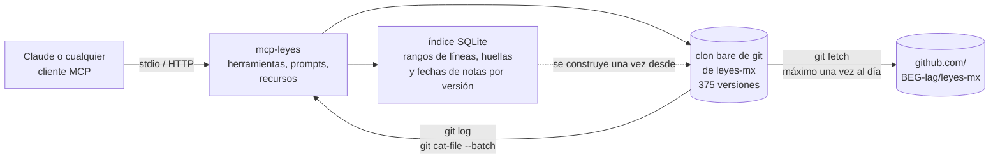

<p align="center">
  
</p>

<p align="center">
  <a href="README.md">English</a> · <b>Español</b>
</p>

<p align="center">
  <a href="https://github.com/BEG-lag/mcp-leyes/actions/workflows/ci.yml"></a>
  
  
  <a href="https://github.com/BEG-lag/leyes-mx"></a>
  
</p>

**mcp-leyes** es un servidor [Model Context Protocol](https://modelcontextprotocol.io) que da a
Claude y a otros agentes de IA acceso a la ley federal mexicana *en el tiempo*: el texto exacto
de un artículo tal como estaba en cualquier fecha, cada cambio que tuvo, diffs palabra por
palabra de lo que hizo una reforma, búsqueda de texto completo sobre las leyes como se leían un
día determinado y la cronología de reformas de cada ley. Lee el repositorio público
[leyes-mx](https://github.com/BEG-lag/leyes-mx), donde 36 leyes federales son archivos Markdown
y cada una de sus 375 versiones archivadas es un commit de git fechado el día de su publicación
en el *Diario Oficial de la Federación* (DOF).

Los abogados preguntan todo el tiempo "¿qué decía el artículo 27 en 2013?" o "¿qué cambió
exactamente la reforma laboral de 2019?". Responder de memoria es la forma en que un modelo
termina citando un párrafo derogado. Este servidor responde con el texto archivado, cita la
fecha del DOF, el decreto y la línea en GitHub, y dice lo que el archivo no puede saber.

> [!IMPORTANT]
> No oficial. Solo el DOF es fuente auténtica. No es asesoría legal.

## Demo

Salida real, grabada con un cliente MCP real por stdio el 17-11-2026, a partir de un caché
vacío. Los fragmentos se copiaron tal cual (`…` marca líneas omitidas); la transcripción completa
y sin editar está en [`docs/demo.md`](docs/demo.md).

**El artículo 27 constitucional al 1 de enero de 2013**, con su procedencia y lo que el archivo
no permite saber:

```markdown
<!-- get_article(law="CPEUM", article="27", date="2013-01-01") · 0.02 s -->
# CPEUM · Artículo 27.

**Constitución Política de los Estados Unidos Mexicanos** › Título Primero › Capítulo I · De los Derechos Humanos y sus Garantías

Texto aplicable al 01-01-2013: versión DOF 15-10-2012 (commit [`9cdbce4`](https://github.com/BEG-lag/leyes-mx/commit/9cdbce4657f0fd3189d9b20e69314b6b7be67d0b)).
…
- El texto de este artículo no cambia desde la versión DOF 13-10-2011 ([`b6d33e0`](https://github.com/BEG-lag/leyes-mx/commit/b6d33e0468615bad79d0c51658d5273bede92e47)).
- En GitHub: [leyes/cpeum.md, líneas 529-639, commit 9cdbce4](https://github.com/BEG-lag/leyes-mx/blob/9cdbce4657f0fd3189d9b20e69314b6b7be67d0b/leyes/cpeum.md?plain=1#L529-L639)

**Advertencias**

- Entre el DOF 15-10-2012 y el 01-01-2013 se publicaron reformas sin versión propia en el archivo (DOF 30-11-2012: DECRETO por el que se reforma el Artículo 40 de la Constitución Política de los Estados Unidos Mexicanos.). Su texto aparece en la siguiente versión del archivo, DOF 26-02-2013; el texto mostrado NO las refleja.
- Esta versión agrupa 3 reformas publicadas entre el DOF 25-06-2012 y el 15-10-2012: no hay copia archivada intermedia, así que el commit lleva la fecha de la última.
- En la siguiente versión archivada (DOF 26-02-2013) este artículo no cambia: esas reformas no lo modificaron.
```

**El mismo artículo, 2013 contra hoy**: las reformas energéticas de 2013 y de 2024 a 2025,
palabra por palabra.

```markdown
<!-- diff_article(law="CPEUM", article="27", date_from="2013-01-01") · 0.14 s -->
# CPEUM · Artículo 27. · DOF 15-10-2012 → DOF 07-10-2026
…
- DOF 10-02-2014 · modificado · nota editorial: DOF 20-12-2013
- DOF 29-01-2016 · modificado · nota editorial: DOF 29-01-2016
…
- DOF 01-04-2025 · modificado · nota editorial: DOF 17-03-2025
…
… Tratándose [-del petróleo y de los carburos de hidrógeno sólidos, líquidos o gaseosos o-] de minerales [-radioactivos,-] {+radiactivos y litio+} no se otorgarán concesiones [-ni contratos, ni subsistirán los que en su caso se hayan otorgado y la Nación llevará a cabo la explotación de esos productos, en los términos que señale la Ley Reglamentaria respectiva-]. Corresponde exclusivamente a la Nación [-generar, conducir, transformar, distribuir-] {+la planeación+} y [-abastecer-] {+el control del sistema eléctrico nacional en los términos del artículo 28 de esta Constitución, así como el servicio público de transmisión y distribución de+} energía eléctrica …
```

**Qué cambió la reforma laboral de 2019 en la Ley Federal del Trabajo.** El archivo no tiene
copia entre el 01-05-2019 y el 02-07-2019, así que la herramienta lo dice y usa las notas
editoriales de la Cámara para separar los artículos de este decreto de los de los otros dos:

```markdown
<!-- diff_reform(law="LFT", reform_date="2019-05-01", limit=3) · 0.03 s -->
# LFT · reforma DOF 01-05-2019
…
Comparación: versión DOF 22-06-2018 ([`2ed3ea7`](https://github.com/BEG-lag/leyes-mx/commit/2ed3ea76ea8f4392c157407ddd139a6c93fe591e)) → versión DOF 02-07-2019 ([`8157e28`](https://github.com/BEG-lag/leyes-mx/commit/8157e2821aba6a04c1e889a8d38f38848c3ec2f0)).

**Resumen**

- 475 artículo(s) modificado(s), 96 añadido(s), 0 que ya no aparece(n).
- De ellos, 559 tienen una nota editorial que cita el DOF 01-05-2019.
- Transitorios nuevos de 3 decreto(s) (DOF 01-05-2019, 04-06-2019, 02-07-2019): consúltalos con `transitorios`.
…
**Sin esa nota (12; otras reformas de la versión o cambios editoriales):** 170 Bis. (añadido), 331 Bis. (añadido), 331 Ter. (añadido), 334 Bis. (añadido), 335., 336 Bis. (añadido), 337 Bis. (añadido), 339., 341., 343., 542., 641-A.
…
## Artículo 3o. (modificado; nota cita DOF 01-05-2019)

[-El trabajo es un derecho y un deber sociales. No es artículo de comercio.-]
…
```

Y no promete más de lo que sabe. Si se le pide el artículo 371 (estatutos sindicales) al 1 de
junio de 2019, un mes después de la reforma, devuelve el último texto archivado y advierte que
está desactualizado para esa fecha:

```markdown
<!-- get_article(law="LFT", article="371", date="2019-06-01") · 0.00 s -->
# LFT · Artículo 371.
…
Texto aplicable al 01-06-2019: versión DOF 22-06-2018 (commit [`2ed3ea7`](https://github.com/BEG-lag/leyes-mx/commit/2ed3ea76ea8f4392c157407ddd139a6c93fe591e)).
…
- En la siguiente versión archivada (DOF 02-07-2019) este artículo sí cambia y su nota editorial cita la reforma del DOF 01-05-2019, publicada antes del 01-06-2019: el texto mostrado está desactualizado para esa fecha. Usa diff_article o la fecha 2019-07-02 para ver el cambio.
```

La transcripción también trae la historia completa del artículo 27 (10 cambios en 44 versiones,
dos marcados como correcciones editoriales), los transitorios del decreto de 2019, una búsqueda
de `subcontrat "servicios especializados"`, la cronología de reformas de la LFT, la reforma a
la LISR del 13-11-2026 que aún no está consolidada y una versión del Código de Comercio cuya
fuente se salta el artículo 291.

**Primera sincronización:** 7.0 s con el caché vacío y una conexión doméstica, clonando leyes-mx
desde GitHub e indexando 375 versiones; el caché ocupa después 29 MB. Todas las llamadas
siguientes se responden en local, en milisegundos.

Cosas que puedes pedir una vez conectado (ejemplos de prompts, no respuestas grabadas):

- *"¿Qué decía el artículo 123 constitucional, apartado A, fracción IV, antes de la reforma de la jornada de 40 horas?"*
- *"Explícame qué cambió la reforma laboral de 2019 en negociación colectiva."* (usa el prompt `explain_reform`)
- *"¿Qué decía el artículo 15-A de la LFT sobre subcontratación y cuándo se derogó?"*
- *"¿Desde cuándo aparece «beneficiario controlador» en el Código Fiscal?"*

## Instalación

Necesitas [uv](https://docs.astral.sh/uv/) y [git](https://git-scm.com/downloads). `uvx`
descarga y ejecuta el servidor; git es su base de datos.

**Claude Code**

```bash
claude mcp add leyes -- uvx --from git+https://github.com/BEG-lag/mcp-leyes mcp-leyes
```

**Claude Desktop**: agrega esto a `claude_desktop_config.json`
(macOS: `~/Library/Application Support/Claude/`, Windows: `%APPDATA%\Claude\`) y reinicia:

```json
{
  "mcpServers": {
    "leyes": {
      "command": "uvx",
      "args": ["--from", "git+https://github.com/BEG-lag/mcp-leyes", "mcp-leyes"]
    }
  }
}
```

El primer arranque clona leyes-mx (unos 4 MB) y arma el índice en unos segundos; después
funciona sin red. Para hacerlo por adelantado:
`uvx --from git+https://github.com/BEG-lag/mcp-leyes mcp-leyes sync`.

**Docker**: cada versión publica una imagen multiarquitectura (linux/amd64, linux/arm64) en
GitHub Container Registry, con git y una copia de leyes-mx adentro, así que responde incluso con
`--network none`. En la configuración de cualquier cliente usa `"command": "docker"` con estos
argumentos:

```bash
docker run -i --rm ghcr.io/beg-lag/mcp-leyes:1.0.0
```

**Cualquier otro cliente MCP**: ejecuta `mcp-leyes` por stdio, o
`mcp-leyes --transport http --port 8000` para HTTP en `http://127.0.0.1:8000/mcp`.

Los metadatos para el [Registro MCP](https://registry.modelcontextprotocol.io) están en
[`server.json`](server.json), con el nombre `io.github.BEG-lag/mcp-leyes`.

## Herramientas

| Herramienta | Qué hace |
| --- | --- |
| `list_laws()` | El catálogo: abreviatura, nombre, última reforma, artículos, versiones en git y la versión archivada más antigua de cada ley. |
| `get_article(law, article, date)` | Texto exacto de un artículo en una fecha (por omisión, hoy): fecha DOF y commit de la versión, los decretos que recoge, desde cuándo el artículo dice eso, las notas editoriales, un enlace a las líneas exactas en GitHub en ese commit y todas las advertencias que apliquen. |
| `article_history(law, article)` | Cada versión que añadió, cambió, derogó o eliminó el artículo, con su decreto. En versiones agrupadas, el decreto que señala la nota editorial; los cambios que solo tocan notas o unas pocas palabras sin nota de reforma se marcan como editoriales. |
| `diff_article(law, article, date_from, date_to, mode)` | Qué cambió entre dos fechas, como diff por palabras (`[-antes-] {+después+}`) o unificado, más las versiones intermedias que lo tocaron. |
| `diff_reform(law, reform_date, mode, limit, offset)` | Qué hizo una reforma: artículos modificados, añadidos y eliminados, transitorios y encabezados nuevos, y los diffs, paginados. |
| `search(query, law, date, limit, include_transitorios)` | Búsqueda de texto completo sobre las leyes como se leían en una fecha. Sin acentos ni mayúsculas, por prefijos, con `"frases"` y `-exclusiones`. |
| `reforms(law, since, limit)` | Decretos de reforma de una ley (número, fecha DOF, título, PDF) y qué versión en git lleva cada uno. |
| `transitorios(law, decree_date, date, max_chars)` | Artículos transitorios del texto original o de un decreto: entrada en vigor, plazos, derogaciones. |

También expone los prompts **`explain_reform(law, reform_date, audience, language)`** y
**`trace_article(law, article, language)`**, y los recursos `ley://{law}@{date}` (la ley
completa en una fecha, en Markdown), `ley://{law}/articulo/{article}@{date}`,
`leyes://catalogo` (JSON) y `leyes://estado` (estado de la sincronización). Las leyes aceptan
abreviatura (`LFT`) o slug (`lft`); los artículos, `27`, `1o`, `3o. Bis`, `15-A`, `353-Ñ`,
`29-A Bis` o `21 bis 1`; las fechas, `AAAA-MM-DD`, `DD-MM-AAAA` u `hoy`. Todas las herramientas
están anotadas como de solo lectura.

## Cómo funciona



**git es la base de datos.** leyes-mx ya guarda lo que necesita un servicio en el tiempo: un
commit por cada versión archivada de cada ley, fechado el día de la publicación en el DOF que
refleja, con los decretos en el mensaje. mcp-leyes mantiene un clon bare y le pregunta
directamente a git: `git log` lista las versiones de una ley y un solo proceso
`git cat-file --batch` lee cualquiera. Nada se convierte ni se duplica, y "la versión vigente en
una fecha" es simplemente el último commit en o antes de esa fecha.

**Un clon completo, no `--filter=blob:none`.** Un clon sin blobs parece más ligero (0.3 MB contra
4.3 MB), pero entonces cada versión histórica se descarga de GitHub la primera vez que se lee:
unos 0.7 s por versión, 375 viajes de red para armar el índice y ninguna respuesta sin
conexión. La historia completa de las 36 leyes comprime a 4.3 MB (179 MB de texto en 375
versiones), así que el clon completo es más rápido y es la única forma de trabajar sin red.
Medido el 17-11-2026: clon bare completo 1.4 s, descarga perezosa de un blob 0.7 s.

**Un índice SQLite pequeño.** La primera vez (y cada vez que el clon avanza), cada versión nueva
se analiza una sola vez: el rango de líneas de cada artículo y de cada bloque de transitorios,
una huella de su texto que ignora espacios y las fechas DOF que citan las notas editoriales de
la Cámara (`*Párrafo reformado DOF 01-05-2019*`). Eso toma unos 5 s para las 375 versiones y
permite responder "cuándo cambió este artículo" o "qué tocó esta reforma" sin leer todas las
versiones. Los textos siempre se leen de git; el índice solo dice dónde buscar.

**Actualización y uso sin red.** `git fetch` corre como máximo una vez cada
`MCP_LEYES_REFRESH_HOURS` (24 por omisión) y solo se indexan las versiones nuevas. Si el fetch
falla, el clon en caché sigue respondiendo y el error aparece en `leyes://estado`; se reintenta
una hora después. Si git no está instalado, cada herramienta lo dice y explica cómo instalarlo.

## Precisión: lo que los datos dicen y lo que no

mcp-leyes nunca afirma más precisión de la que tiene leyes-mx, y cada herramienta imprime las
advertencias que aplican a su respuesta:

- **Publicación no es entrada en vigor.** La fecha de una versión es la de la publicación en el
  DOF de la reforma que refleja. Cuándo surtió efectos lo fijan sus transitorios, que la
  herramienta `transitorios` devuelve textualmente.
- **La historia empieza en la copia archivada más antigua.** leyes-mx reconstruyó la historia a
  partir de capturas del Internet Archive, así que la mayoría de las leyes empieza entre 2004 y
  2006 (la Ley Agraria en 1993). Una fecha anterior a la versión más antigua es un error que lo
  dice, no una suposición.
- **Reformas agrupadas.** Cuando se publicaron varias reformas entre dos copias archivadas, un
  solo commit las lleva todas, con la fecha de la última. Para una fecha dentro de ese hueco, la
  herramienta advierte que el texto no refleja las reformas publicadas en medio, revisa si la
  siguiente versión cambia el artículo y, si lo cambia, usa las notas editoriales para decir qué
  decreto lo hizo.
- **Irregularidades de numeración de la fuente.** 14 versiones archivadas tienen anomalías de
  numeración que vienen de los archivos fuente (13 Códigos de Comercio antiguos escriben el
  artículo 291 como `29l`; la Ley Federal de Competencia Económica de 2014 incluye artículos de
  otra ley). El índice las detecta con la misma regla que usa leyes-mx y toda respuesta basada en
  esas versiones lo advierte.
- **Correcciones editoriales.** A veces la Cámara corrige ortografía o agrega notas sin que haya
  reforma. `article_history` y `diff_reform` marcan como posibles correcciones editoriales los
  cambios que solo tocan notas, o que cambian unas pocas palabras sin una nota de reforma nueva.
- **Todavía sin consolidar.** Cuando LeyesBiblio registra una reforma que el texto consolidado
  aún no incluye (al momento de escribir esto, la reforma a la LISR del 13-11-2026), las
  respuestas para fechas posteriores lo dicen.
- **Textos consolidados, no el DOF.** Los textos son las versiones consolidadas de la Cámara de
  Diputados, convertidas por leyes-mx. La consolidación puede tener errores; prevalece el DOF.

## Configuración

| Variable | Por omisión | Qué hace |
| --- | --- | --- |
| `MCP_LEYES_CACHE` | `~/Library/Caches/mcp-leyes` (macOS), `$XDG_CACHE_HOME/mcp-leyes` o `~/.cache/mcp-leyes` (Linux), `%LOCALAPPDATA%\mcp-leyes` (Windows) | Dónde viven el clon y el índice (un subdirectorio por fuente). |
| `MCP_LEYES_SOURCE` | `https://github.com/BEG-lag/leyes-mx.git` | URL de git o ruta local de donde clonar (un clon local o un fork). |
| `MCP_LEYES_REFRESH_HOURS` | `24` | Horas entre fetches; `0` nunca hace fetch. |
| `MCP_LEYES_WEB_URL` | se deriva de la fuente; si no, `https://github.com/BEG-lag/leyes-mx` | Base de los enlaces a GitHub en las respuestas. |

## Estructura del proyecto

```text
src/mcp_leyes/
  server.py      app FastMCP: herramientas, recursos, prompts, CLI (serve, sync, --version)
  corpus.py      sincronización, índice y consultas en el tiempo con sus advertencias
  gitrepo.py     plomería de git: clon bare, fetch, log, cat-file --batch
  index.py       índice SQLite de rangos de artículos por versión
  articles.py    encabezados de leyes-mx a artículos, rangos y transitorios; revisión de numeración
  commits.py     decretos y agrupación a partir de los mensajes de commit de leyes-mx
  diffing.py     diffs por párrafo y por palabra, detección de cambios editoriales
  search.py      consultas sin acentos, fragmentos
  formatting.py  respuestas en Markdown, en español
tests/           suite sin red sobre un repositorio git de prueba creado en el test, más pruebas en vivo opcionales
scripts/         demo.py (escribe docs/demo.md), smoke_stdio.py (handshake y consulta sin red)
Dockerfile       imagen con git y una copia de leyes-mx (ghcr.io/beg-lag/mcp-leyes)
server.json      metadatos para el Registro MCP
```

## Desarrollo

```bash
uv sync
uv run pytest                 # sin red: arma una ley falsa con tres versiones en un repo git temporal
uv run pytest --live -m live  # opcional: el leyes-mx real (MCP_LEYES_LIVE_SOURCE para un clon local)
uv run ruff check . && uv run ruff format --check .
uv run python scripts/demo.py # ida y vuelta MCP real por stdio, desde un caché vacío
docker build -t mcp-leyes . && uv run python scripts/smoke_stdio.py --query -- docker run -i --rm --network none mcp-leyes
```

La suite sin red no necesita conexión: crea con git un pequeño parecido de leyes-mx (tres
versiones de una ley falsa, un commit agrupado, un encabezado de rango, `3o. Bis`, `15-A`,
`15-Ñ`, transitorios del texto original y de cada decreto, un encabezado repetido) y prueba
todas las herramientas contra él, incluido un handshake real por stdio. CI corre ruff y la suite
en Python 3.12, 3.13 y 3.14, valida `server.json` contra el esquema oficial del Registro MCP y
construye el contenedor y lo consulta con la red apagada. Un tag `vX.Y.Z` publica la imagen en
GHCR. Un workflow semanal corre las pruebas en vivo contra el repositorio real.

## Limitaciones

- **La cobertura es la de leyes-mx**: 36 leyes y códigos federales, con historia solo donde el
  Internet Archive guardó copia. No incluye reglamentos, NOM, leyes estatales ni jurisprudencia.
- **Granularidad de artículo.** Las respuestas son artículos completos; fracciones y párrafos
  están en el texto pero no se consultan por separado (`27, fracción IV` devuelve el artículo 27
  y avisa que ignoró el resto).
- **Transitorios** son bloques por decreto, no artículos individuales, y los de un decreto
  aparecen a partir de la primera versión archivada posterior a su publicación.
- **La búsqueda** es léxica (prefijos sin acentos), no semántica, y cubre el cuerpo de los
  artículos salvo que se pida `include_transitorios`.
- **La detección de cambios editoriales es una heurística** (solo cambian notas, o a lo más tres
  palabras por cambio sin nota de reforma nueva). Se etiqueta "posible corrección editorial" y el
  diff está a una llamada.
- **Requiere git** en la máquina (la imagen de Docker lo incluye).

## Aviso

No oficial. Solo el DOF es fuente auténtica. No es asesoría legal. Este proyecto no está
afiliado a la Cámara de Diputados, al DOF ni al Internet Archive. Verifica cualquier conclusión
jurídica contra la publicación oficial y con la autoridad competente.

## Autor

Hecho por **Benjamín Esponda García**, abogado corporativo mexicano (energía, hidrocarburos y
minería) que construye con IA. Más en [pivotek.mx](https://pivotek.mx) y en el
[portafolio](https://github.com/BEG-lag/portafolio-ia). Proyectos hermanos:
[leyes-mx](https://github.com/BEG-lag/leyes-mx), la ley como código que lee este servidor, y
[mcp-dof](https://github.com/BEG-lag/mcp-dof), el DOF diario como herramientas MCP.

Código bajo [licencia MIT](LICENSE). Los textos de las leyes vienen de leyes-mx; consulta su
[DATA-LICENSE](https://github.com/BEG-lag/leyes-mx/blob/main/DATA-LICENSE.md).
