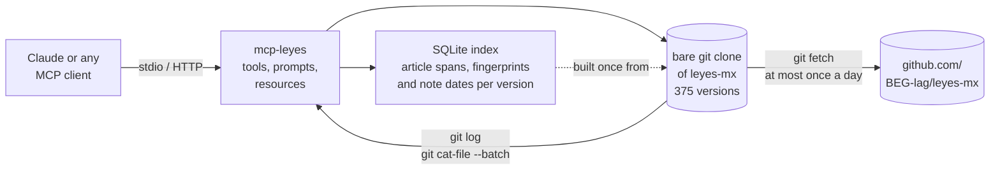

<p align="center">
  <a href="https://pivotek.mx"></a>
</p>

<p align="center">
  
</p>

<p align="center">
  <b>English</b> · <a href="README.es.md">Español</a>
</p>

<p align="center">
  <a href="https://github.com/BEG-lag/mcp-leyes/actions/workflows/ci.yml"></a>
  
  
  <a href="https://github.com/BEG-lag/leyes-mx"></a>
  
  <a href="https://registry.modelcontextprotocol.io/v0.1/servers?search=io.github.BEG-lag/mcp-leyes"></a>
</p>

<!-- mcp-name: io.github.BEG-lag/mcp-leyes -->

**mcp-leyes** is a [Model Context Protocol](https://modelcontextprotocol.io) server that gives
Claude and other AI agents *point-in-time* access to Mexican federal law: the exact text of an
article as it stood on any date, every change it went through, word-level diffs of what a reform
did, full-text search over the laws as they read on a given day, and the reform timeline of each
law. It reads the public [leyes-mx](https://github.com/BEG-lag/leyes-mx) repository, where 36
federal laws are Markdown files and each of their 375 archived versions is a git commit dated on
its publication in the *Diario Oficial de la Federación* (DOF).

Lawyers ask "what did article 27 say in 2013?" or "what exactly did the 2019 labor reform change?"
all the time. Answering from memory is how a model ends up citing a repealed paragraph. This
server answers from the archived text, cites the DOF date, the decree and the line on GitHub,
and says what the archive cannot know.

> [!IMPORTANT]
> Unofficial. Only the DOF is authoritative. Not legal advice.

## Demo

Real output, recorded through a real MCP client over stdio on 2026-11-17, starting from an empty
cache. Excerpts below are copied verbatim (`…` marks omitted lines); the full, unedited
transcript is in [`docs/demo.md`](docs/demo.md). Tool output is in Spanish, like the law.

**Article 27 of the Constitution on January 1, 2013**, with where the text comes from and what
the archive cannot tell:

```markdown
<!-- get_article(law="CPEUM", article="27", date="2013-01-01") · 0.02 s -->
# CPEUM · Artículo 27.

**Constitución Política de los Estados Unidos Mexicanos** › Título Primero › Capítulo I · De los Derechos Humanos y sus Garantías

Texto aplicable al 01-01-2013: versión DOF 15-10-2012 (commit [`9cdbce4`](https://github.com/BEG-lag/leyes-mx/commit/9cdbce4657f0fd3189d9b20e69314b6b7be67d0b)).
…
- El texto de este artículo no cambia desde la versión DOF 13-10-2011 ([`b6d33e0`](https://github.com/BEG-lag/leyes-mx/commit/b6d33e0468615bad79d0c51658d5273bede92e47)).
- En GitHub: [leyes/cpeum.md, líneas 529-639, commit 9cdbce4](https://github.com/BEG-lag/leyes-mx/blob/9cdbce4657f0fd3189d9b20e69314b6b7be67d0b/leyes/cpeum.md?plain=1#L529-L639)

**Advertencias**

- Entre el DOF 15-10-2012 y el 01-01-2013 se publicaron reformas sin versión propia en el archivo (DOF 30-11-2012: DECRETO por el que se reforma el Artículo 40 de la Constitución Política de los Estados Unidos Mexicanos.). Su texto aparece en la siguiente versión del archivo, DOF 26-02-2013; el texto mostrado NO las refleja.
- Esta versión agrupa 3 reformas publicadas entre el DOF 25-06-2012 y el 15-10-2012: no hay copia archivada intermedia, así que el commit lleva la fecha de la última.
- En la siguiente versión archivada (DOF 26-02-2013) este artículo no cambia: esas reformas no lo modificaron.
```

**The same article, 2013 versus today**: the energy reforms of 2013 and 2024 to 2025, word by word.

```markdown
<!-- diff_article(law="CPEUM", article="27", date_from="2013-01-01") · 0.14 s -->
# CPEUM · Artículo 27. · DOF 15-10-2012 → DOF 07-10-2026
…
- DOF 10-02-2014 · modificado · nota editorial: DOF 20-12-2013
- DOF 29-01-2016 · modificado · nota editorial: DOF 29-01-2016
…
- DOF 01-04-2025 · modificado · nota editorial: DOF 17-03-2025
…
… Tratándose [-del petróleo y de los carburos de hidrógeno sólidos, líquidos o gaseosos o-] de minerales [-radioactivos,-] {+radiactivos y litio+} no se otorgarán concesiones [-ni contratos, ni subsistirán los que en su caso se hayan otorgado y la Nación llevará a cabo la explotación de esos productos, en los términos que señale la Ley Reglamentaria respectiva-]. Corresponde exclusivamente a la Nación [-generar, conducir, transformar, distribuir-] {+la planeación+} y [-abastecer-] {+el control del sistema eléctrico nacional en los términos del artículo 28 de esta Constitución, así como el servicio público de transmisión y distribución de+} energía eléctrica …
```

**What the 2019 labor reform changed in the Ley Federal del Trabajo.** The archive has no copy
between 01-05-2019 and 02-07-2019, so the tool says so and uses the Cámara's editorial notes to
tell the articles of this decree from those of the other two:

```markdown
<!-- diff_reform(law="LFT", reform_date="2019-05-01", limit=3) · 0.03 s -->
# LFT · reforma DOF 01-05-2019
…
Comparación: versión DOF 22-06-2018 ([`2ed3ea7`](https://github.com/BEG-lag/leyes-mx/commit/2ed3ea76ea8f4392c157407ddd139a6c93fe591e)) → versión DOF 02-07-2019 ([`8157e28`](https://github.com/BEG-lag/leyes-mx/commit/8157e2821aba6a04c1e889a8d38f38848c3ec2f0)).

**Resumen**

- 475 artículo(s) modificado(s), 96 añadido(s), 0 que ya no aparece(n).
- De ellos, 559 tienen una nota editorial que cita el DOF 01-05-2019.
- Transitorios nuevos de 3 decreto(s) (DOF 01-05-2019, 04-06-2019, 02-07-2019): consúltalos con `transitorios`.
…
**Sin esa nota (12; otras reformas de la versión o cambios editoriales):** 170 Bis. (añadido), 331 Bis. (añadido), 331 Ter. (añadido), 334 Bis. (añadido), 335., 336 Bis. (añadido), 337 Bis. (añadido), 339., 341., 343., 542., 641-A.
…
## Artículo 3o. (modificado; nota cita DOF 01-05-2019)

[-El trabajo es un derecho y un deber sociales. No es artículo de comercio.-]
…
```

And it refuses to over-claim. Asked for article 371 (union bylaws) on June 1, 2019, a month after
the reform, it returns the last archived text and flags it as outdated for that date:

```markdown
<!-- get_article(law="LFT", article="371", date="2019-06-01") · 0.00 s -->
# LFT · Artículo 371.
…
Texto aplicable al 01-06-2019: versión DOF 22-06-2018 (commit [`2ed3ea7`](https://github.com/BEG-lag/leyes-mx/commit/2ed3ea76ea8f4392c157407ddd139a6c93fe591e)).
…
- En la siguiente versión archivada (DOF 02-07-2019) este artículo sí cambia y su nota editorial cita la reforma del DOF 01-05-2019, publicada antes del 01-06-2019: el texto mostrado está desactualizado para esa fecha. Usa diff_article o la fecha 2019-07-02 para ver el cambio.
```

The transcript also has the full history of article 27 (10 changes in 44 versions, two of them
flagged as editorial corrections), the transitorios of the 2019 decree, a search for
`subcontrat "servicios especializados"`, the LFT reform timeline, the LISR reform of
13-11-2026 that is not consolidated yet, and a Código de Comercio version whose source skips
article 291.

**First sync:** 7.0 s from an empty cache on a home connection, cloning leyes-mx from GitHub
and indexing 375 versions; the cache then takes 29 MB. Every later call is answered locally, in
milliseconds.

Things you can ask once it is connected (example prompts, not recorded answers):

- *"¿Qué decía el artículo 123 constitucional, apartado A, fracción IV, antes de la reforma de la jornada de 40 horas?"*
- *"Explain what the 2019 labor reform changed in collective bargaining."* (uses the `explain_reform` prompt)
- *"¿Qué decía el artículo 15-A de la LFT sobre subcontratación y cuándo se derogó?"*
- *"¿Desde cuándo aparece «beneficiario controlador» en el Código Fiscal?"*

## Quickstart

You need [uv](https://docs.astral.sh/uv/) and [git](https://git-scm.com/downloads). `uvx`
downloads and runs the server; git is its database.

**Claude Code**

```bash
claude mcp add leyes -- uvx --from git+https://github.com/BEG-lag/mcp-leyes mcp-leyes
```

**Claude Desktop**: add this to `claude_desktop_config.json`
(macOS: `~/Library/Application Support/Claude/`, Windows: `%APPDATA%\Claude\`) and restart:

```json
{
  "mcpServers": {
    "leyes": {
      "command": "uvx",
      "args": ["--from", "git+https://github.com/BEG-lag/mcp-leyes", "mcp-leyes"]
    }
  }
}
```

The first start clones leyes-mx (about 4 MB) and builds the index in a few seconds; after that it
works offline. To do that ahead of time, run
`uvx --from git+https://github.com/BEG-lag/mcp-leyes mcp-leyes sync`.

**Docker**: every release publishes a multi-arch image (linux/amd64, linux/arm64) to GitHub
Container Registry, with git and a snapshot of leyes-mx inside, so it answers even with
`--network none`. In any client config, use `"command": "docker"` with these arguments:

```bash
docker run -i --rm ghcr.io/beg-lag/mcp-leyes:1.0.0
```

**Any other MCP client**: run `mcp-leyes` over stdio, or `mcp-leyes --transport http --port 8000`
for streamable HTTP at `http://127.0.0.1:8000/mcp`.

The metadata for the [MCP Registry](https://registry.modelcontextprotocol.io) lives in
[`server.json`](server.json), under the name `io.github.BEG-lag/mcp-leyes`.

## Tools

| Tool | What it does |
| --- | --- |
| `list_laws()` | The catalog: abbreviation, name, last reform, articles, versions in git and the oldest archived version of each law. |
| `get_article(law, article, date)` | Exact text of an article as it stood on a date (default today): version DOF date and commit, the decrees that version reflects, since when the article reads that way, the editorial notes, a link to the exact lines on GitHub at that commit, and every caveat that applies. |
| `article_history(law, article)` | Every version that added, changed, repealed or dropped the article, with its decree. In grouped versions, the decree named by the editorial note; changes that only touch notes or a few words without a reform note are flagged as editorial. |
| `diff_article(law, article, date_from, date_to, mode)` | What changed between two dates, as a word diff (`[-old-] {+new+}`) or a unified diff, plus the versions in between that touched it. |
| `diff_reform(law, reform_date, mode, limit, offset)` | What a reform did: articles modified, added and removed, new transitorios and headings, and the diffs, paginated. |
| `search(query, law, date, limit, include_transitorios)` | Full-text search over the laws as they read on a date. Accent and case insensitive, prefix matching, `"phrases"` and `-exclusions`. |
| `reforms(law, since, limit)` | Reform decrees of a law (number, DOF date, title, PDF) and which version in git carries each one. |
| `transitorios(law, decree_date, date, max_chars)` | Transitory articles of the original text or of one decree: entry into force, deadlines, repeals. |

Also exposed: the prompts **`explain_reform(law, reform_date, audience, language)`** and
**`trace_article(law, article, language)`**, and the resources `ley://{law}@{date}` (the whole
law as it stood on a date, Markdown), `ley://{law}/articulo/{article}@{date}`,
`leyes://catalogo` (JSON) and `leyes://estado` (sync status). Laws accept the abbreviation
(`LFT`) or slug (`lft`); articles accept `27`, `1o`, `3o. Bis`, `15-A`, `353-Ñ`, `29-A Bis` or
`21 bis 1`; dates accept `YYYY-MM-DD`, `DD-MM-YYYY` or `hoy`. All tools are annotated read-only.

## How it works



**git is the database.** leyes-mx already stores what a point-in-time service needs: one commit
per archived version of each law, dated on the DOF publication it reflects, with the decrees in
the commit message. mcp-leyes keeps a bare clone of it and asks git directly: `git log` lists
the versions of a law, and one long-lived `git cat-file --batch` process reads any of them.
Nothing is converted or duplicated, and "the version in force on a date" is simply the last
commit on or before that date.

**A full clone, not `--filter=blob:none`.** A blobless clone looks lighter (0.3 MB against
4.3 MB), but then every historical version is fetched from GitHub the first time it is read:
about 0.7 s per version, 375 network round trips to build the index, and no answer at all
offline. The full history of all 36 laws compresses to 4.3 MB (179 MB of text across 375
versions), so the full clone is both faster and the only way to work offline. Measured on
2026-11-17: full bare clone 1.4 s, one lazy blob fetch 0.7 s.

**A small SQLite index.** On first use (and whenever the clone moves), each new version is
parsed once: the line span of every article and every block of transitorios, a whitespace
insensitive fingerprint of its text, and the DOF dates cited by the Cámara's editorial notes
(`*Párrafo reformado DOF 01-05-2019*`). That takes about 5 s for all 375 versions and answers
"when did this article change" or "what did this reform touch" without reading every version.
Texts are always read from git; the index only says where to look.

**Updates and offline use.** `git fetch` runs at most once every `MCP_LEYES_REFRESH_HOURS` (24
by default) and only new versions are indexed. If the fetch fails, the cached clone keeps
answering and the error shows up in `leyes://estado`; it is retried an hour later. If git is not
installed, every tool says so and explains how to install it.

## Precision: what the data can and cannot tell you

mcp-leyes never claims more precision than leyes-mx has, and every tool prints the caveats that
apply to its answer:

- **Publication is not entry into force.** A version's date is the DOF publication of the reform
  it reflects. When a reform took effect is set by its transitorios, which the `transitorios`
  tool returns verbatim.
- **History starts at the oldest archived copy.** leyes-mx rebuilt the history from Internet
  Archive captures, so most laws start in 2004 to 2006 (the Ley Agraria in 1993). A date before
  the oldest version is an error that says so, not a guess.
- **Grouped reforms.** When several reforms were published between two archived copies, one
  commit carries all of them, dated on the latest. For a date inside that gap, the tool warns
  that the text does not reflect the reforms published in between, checks whether the next
  version changes the article at all, and, when it does, uses the editorial notes to say which
  decree changed it.
- **Numbering anomalies of the source.** 14 archived versions have article numbering anomalies
  that come from the source files (13 old Códigos de Comercio type article 291 as `29l`; the
  2014 Ley Federal de Competencia Económica bundles articles of another law). The index detects
  them with the same rule leyes-mx uses, and any answer from those versions says so.
- **Editorial corrections.** The Cámara sometimes fixes spelling or adds notes without a reform.
  `article_history` and `diff_reform` flag changes that only touch notes, or swap a few words
  without a new reform note, as possible editorial corrections instead of reforms.
- **Not consolidated yet.** When LeyesBiblio lists a reform that the consolidated text does not
  include yet (as of this writing, the LISR reform of 13-11-2026), answers for later dates say
  so.
- **Consolidated texts, not the DOF.** The texts are the Cámara de Diputados' consolidated
  versions, converted by leyes-mx. Consolidation can contain errors; the DOF prevails.

## Configuration

| Variable | Default | What it does |
| --- | --- | --- |
| `MCP_LEYES_CACHE` | `~/Library/Caches/mcp-leyes` (macOS), `$XDG_CACHE_HOME/mcp-leyes` or `~/.cache/mcp-leyes` (Linux), `%LOCALAPPDATA%\mcp-leyes` (Windows) | Where the clone and the index live (one subdirectory per source). |
| `MCP_LEYES_SOURCE` | `https://github.com/BEG-lag/leyes-mx.git` | Git URL or local path to clone from (a local clone or a fork). |
| `MCP_LEYES_REFRESH_HOURS` | `24` | Hours between fetches; `0` never fetches. |
| `MCP_LEYES_WEB_URL` | derived from the source, else `https://github.com/BEG-lag/leyes-mx` | Base of the GitHub links in answers. |

## Project structure

```text
src/mcp_leyes/
  server.py      FastMCP app: tools, resources, prompts, CLI (serve, sync, --version)
  corpus.py      sync, index refresh and point-in-time queries with their caveats
  gitrepo.py     git plumbing: bare clone, fetch, log, cat-file --batch
  index.py       SQLite index of article spans per version
  articles.py    leyes-mx headings to articles, ranges and transitorios; numbering checks
  commits.py     decrees and grouping from leyes-mx commit messages
  diffing.py     paragraph and word diffs, editorial-change detection
  search.py      accent-insensitive query parsing, snippets
  formatting.py  Markdown answers in Spanish
tests/           offline suite on a fixture git repository built in the test, plus opt-in live tests
scripts/         demo.py (writes docs/demo.md), smoke_stdio.py (handshake and offline query)
Dockerfile       container image with git and a leyes-mx snapshot (ghcr.io/beg-lag/mcp-leyes)
server.json      MCP Registry metadata
```

## Development

```bash
uv sync
uv run pytest                 # offline: builds a three-version fake law in a temporary git repo
uv run pytest --live -m live  # opt in: the real leyes-mx (MCP_LEYES_LIVE_SOURCE for a local clone)
uv run ruff check . && uv run ruff format --check .
uv run python scripts/demo.py # real MCP round trip over stdio, from an empty cache
docker build -t mcp-leyes . && uv run python scripts/smoke_stdio.py --query -- docker run -i --rm --network none mcp-leyes
```

The offline suite needs no network: it builds a small leyes-mx look-alike with git (three
versions of a fake law, a grouped commit, a range heading, `3o. Bis`, `15-A`, `15-Ñ`,
transitorios of the original text and of each decree, a repeated heading) and runs every tool
against it, including a real stdio handshake. CI runs ruff and the suite on Python 3.12, 3.13
and 3.14, validates `server.json` against the official MCP Registry schema, and builds the
container and queries it with the network off. Pushing a `vX.Y.Z` tag publishes the image to
GHCR. A weekly workflow runs the live tests against the real repository.

## Limitations

- **Coverage is leyes-mx's**: 36 federal laws and codes, with history only where the Internet
  Archive kept a copy. No regulations, NOMs, state law or case law.
- **Article granularity.** Answers are whole articles; fractions and paragraphs are in the text
  but not addressed separately (`27, fracción IV` returns article 27 and says it ignored the
  rest).
- **Transitorios** are blocks per decree, not individual articles, and a decree's transitorios
  appear from the first archived version after its publication.
- **Search** is lexical (accent-insensitive prefixes), not semantic, and covers article bodies
  unless `include_transitorios` is set.
- **Editorial-change detection is a heuristic** (only notes changed, or at most three words
  swapped per change without a new reform note). It is labelled "posible corrección editorial"
  and the diff is one call away.
- **Requires git** on the machine (the Docker image includes it).

## Disclaimer

Unofficial. Only the DOF is authoritative. Not legal advice. This project is not affiliated with
the Cámara de Diputados, the DOF or the Internet Archive. Verify any legal conclusion against the
official publication and with the competent authority.

## Author

Built by **Benjamín Esponda García**, a Mexican corporate lawyer (energy, hydrocarbons and
mining) who builds with AI. More at [pivotek.mx](https://pivotek.mx) and in the
[portfolio](https://github.com/BEG-lag/portafolio-ia). Companion projects:
[leyes-mx](https://github.com/BEG-lag/leyes-mx), the law as code that this server reads, and
[mcp-dof](https://github.com/BEG-lag/mcp-dof), the daily DOF as MCP tools.

Code released under the [MIT License](LICENSE). Law texts come from leyes-mx; see its
[DATA-LICENSE](https://github.com/BEG-lag/leyes-mx/blob/main/DATA-LICENSE.md).
